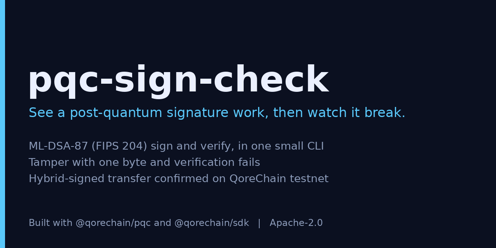

# pqc-sign-check



A small command line tool to sign and verify messages with ML-DSA-87 (FIPS-204), the post-quantum signature scheme QoreChain accounts use. It shows what a post-quantum signature looks like (about 4.6 KB) and that any change to the message or signature makes verification fail.

Built with `@qorechain/pqc` (QoreChain kit, credited) and its dependency `@noble/post-quantum`. License: Apache-2.0.

## Use

    npm install
    node cli.mjs keygen
    node cli.mjs sign <secretKeyHex> "message"
    node cli.mjs verify <publicKeyHex> "message" <sigHex>
    node cli.mjs demo     # sign, verify, then tamper and confirm it fails
    npm test

Status: library, tests and testnet proof are done (see below).

## Testnet proof (QoreChain `qorechain-diana`)

`testnet/` holds two small scripts that use `@qorechain/sdk` on the public testnet only:

- `gen-wallet.mjs` makes a throwaway wallet. The mnemonic goes to a private file and only the address is printed.
- `send-hybrid.mjs` registers the account's ML-DSA-87 key and sends a hybrid-signed (classical + post-quantum) transfer.

```sh
cd testnet && npm install
QORE_MNEMONIC_FILE=~/.qore/mnemonic node send-hybrid.mjs
```

Example run: tx `E40C584F7CC8FA0D0DFC4E5635D8A3D64FF00FDE83F35819F8D53A0A1AE0A355` on `qorechain-diana`, code 0, a hybrid-signed transfer.

## Credits

- [`@qorechain/pqc`](https://www.npmjs.com/package/@qorechain/pqc) and [`@qorechain/sdk`](https://www.npmjs.com/package/@qorechain/sdk) from QoreChain: ML-DSA-87 and SHAKE256 primitives, wallet derivation, hybrid transaction signing.
- [`@noble/post-quantum`](https://github.com/paulmillr/noble-post-quantum) by Paul Miller, used underneath for ML-DSA.
- Category: Quantum Pass (QoreChain Developer Fest, "Build Before Q-Day").
- Testnet address used by this project: `qor1mwhcdn7h6cs690zp8l5naeam2macrkj3tmzcnj` (chain `qorechain-diana`, throwaway, no real value).
- This is a small teaching tool. It has not had a professional security audit; do not use it to protect real funds.
